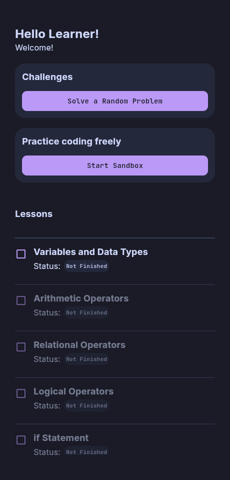
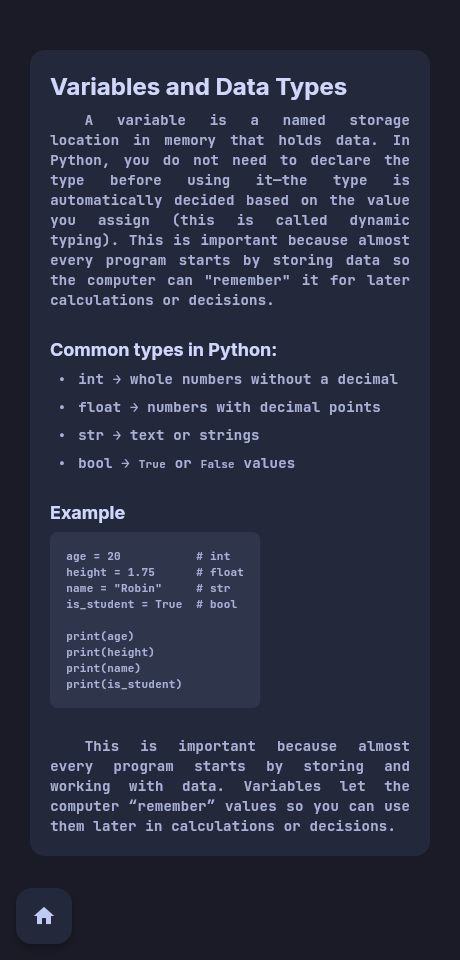

# LogicBlock

A Flutter application for learning Python through lessons, coding problems, and a visual Blockly workspace. Learners assemble blocks, inspect the generated Python, and run it with Skulpt inside the app's WebView.

## Screenshots

<p>
  
  
</p>

These are captures of the existing Flutter home and lesson screens running in a browser at a mobile-sized viewport. The Blockly/Skulpt sandbox uses a mobile WebView and is not shown in this browser preview.

## Features

- Seven lessons covering variables and data types, arithmetic, comparisons, logical operators, `if`, `if/else`, and `while` loops.
- Lesson explanations, example code, and practice problems.
- A Blockly sandbox for assembling programs and viewing their Python code.
- Python execution through the bundled Skulpt interpreter, with output and error messages.
- Flutter input dialogs for Python `input()` prompts.
- Random coding challenges and a free-practice sandbox.
- A locally saved username and lesson completion status, with lessons unlocked in sequence.

## Requirements

- Flutter **3.41.9** with Dart **3.11.5** is the verified setup. The project declares Dart `^3.11.0`; this Flutter version also matches the checked-in package lockfile.
- An Android device/emulator and Android SDK for the complete mobile workflow. Android compilation targets Java/Kotlin 17.
- For iOS, a macOS machine with Xcode and the iOS Flutter toolchain.

The sandbox depends on `webview_flutter` and its Android/iOS implementations. The presence of web and desktop project folders does not provide a working sandbox on those platforms. Home and lesson screens can be previewed on the web.

Main packages include `flutter_markdown_plus`, `shared_preferences`, `splashscreen`, and `webview_flutter`. Blockly, its Python generator, Skulpt, and Skulpt's standard library are bundled under `assets/blockly/`; no separate Python installation is needed to execute learner programs.

## Installation

With Flutter available on your `PATH`:

```bash
git clone https://github.com/LedgeA/LogicBlock.git
cd LogicBlock
flutter pub get --enforce-lockfile
```

For the SDK already downloaded into this project's `.dependencies` folder, Linux users can instead run:

```bash
export PATH="$PWD/.dependencies/flutter/bin:$PATH"
export PUB_CACHE="$PWD/.dependencies/pub-cache"
flutter pub get --enforce-lockfile
```

## Usage

Connect an Android device with USB debugging enabled, or start an emulator:

```bash
flutter devices
flutter run -d <device-id>
```

Replace `<device-id>` with an ID from `flutter devices`. On macOS, an iOS simulator or connected iPhone can be selected in the same way after configuring the iOS toolchain.

1. Enter a username at first launch.
2. Open the first available lesson and read its explanation and problem.
3. Use its coding workspace to assemble Blockly blocks.
4. View the generated Python or press **Run** to execute it.
5. Answer input dialogs when prompted, and review the resulting output or errors.
6. Mark a successfully run lesson as completed to unlock the next lesson. Completion is learner-marked; the app does not automatically grade the solution against the problem.

Use **Start Sandbox** for free practice or **Solve a Random Problem** for a challenge.

To preview the home and lesson interface without a mobile device:

```bash
flutter run -d chrome
```

This preview requires Chrome and does not support the current WebView sandbox.
